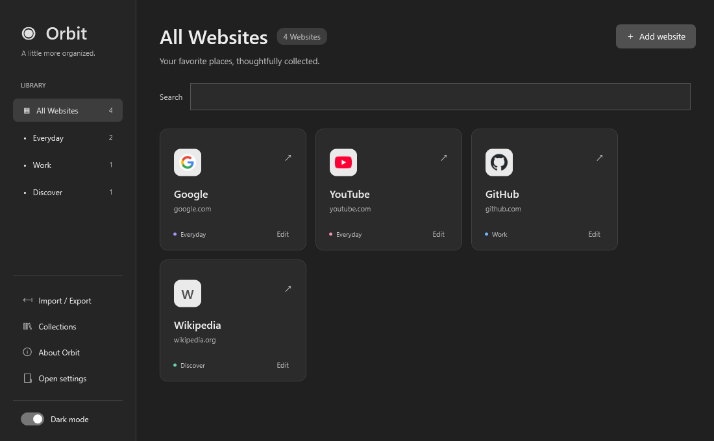
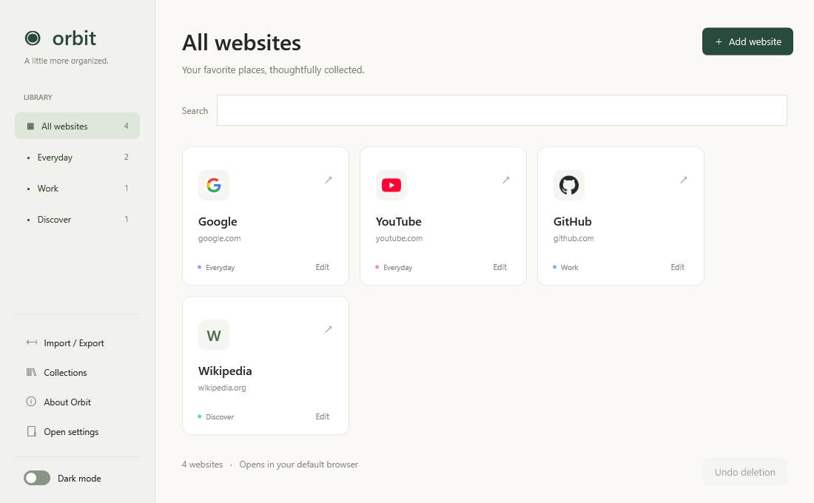

# Orbit

A portable C# / WPF website launcher for Windows.

[**Download for Windows**](https://github.com/donishki/orbit/releases/latest) · [Features](#features) · [Build from source](#build)

## Screenshots

### Charcoal



### Light



## Features

- Website cards with automatic or custom icons
- Collections, search, and drag-to-reorder
- Import/export libraries with custom icons
- Undo shortcut deletion and open collections together
- Light and charcoal themes
- Starts maximized; green outer outlines indicate dragging and focus

## Run

Choose a Windows x64 (64-bit) or x86 (32-bit) download from [Releases](https://github.com/donishki/orbit/releases/latest):

- **Orbit-Setup-win-x64.exe**: installs Orbit for your Windows account, adds a Start menu shortcut, and offers an optional desktop shortcut. Remove it through Windows Settings > Apps.
- **Orbit-Portable-win-x64.zip**: extract and run `Orbit.exe`, without installing.
- **Orbit-Setup-win-x86.exe** / **Orbit-Portable-win-x86.zip**: the equivalent 32-bit versions.

All packages include .NET. Use x64 for 64-bit Windows 10/11, or x86 for 32-bit Windows 10 (also runnable on 64-bit Windows). The installer defaults to `%LOCALAPPDATA%\Programs\Orbit`, requires no administrator password, and preserves links and settings during upgrades and uninstall. The x86 installer uses `%LOCALAPPDATA%\Programs\Orbit-x86` and labels shortcuts “Orbit (32-bit)” so both architectures can coexist. Installed and portable copies share the same settings for your account.

## Settings

Links and preferences are stored in `%LOCALAPPDATA%\Orbit\settings.json`.
**Open settings** opens that folder. The previous save is retained as
`settings.json.bak`. Older Orbit registry or sidecar settings migrate automatically.

Use **Import / Export** to share your library. Copying the executable alone does
not carry personal links. Custom icons and collection order are included in exports;
the theme remains local. Undo history lasts for the current session.

## Build

Requires Windows and the .NET 8 SDK.

```powershell
dotnet publish Orbit.csproj -c Release -r win-x64 --self-contained true -p:PublishSingleFile=true -p:IncludeNativeLibrariesForSelfExtract=true -p:DebugType=None -p:DebugSymbols=false -o release
```

For the 32-bit portable build, replace `win-x64` with `win-x86` and use a separate output directory.

### Build the installer

Install Inno Setup 7, then run:

```powershell
./installer/Build-Installer.ps1
./installer/Build-Installer.ps1 -Architecture x86
```

Use `-IsccPath` for a compiler installed elsewhere. The output is
`release/Orbit-Setup-win-x64.exe` or `release/Orbit-Setup-win-x86.exe`. The installer bundles the runtime as normal
files so the installed app does not need to extract it on launch.

## Checks

```powershell
dotnet run --project tests/StorageChecks.csproj
dotnet run --project tests/FeatureChecks.csproj
dotnet run --project tests/ThemeChecks.csproj
```

Theme checks include live icon downloads; unavailable sites use fallback icons.
See [README.txt](README.txt) for detailed controls and release notes.
